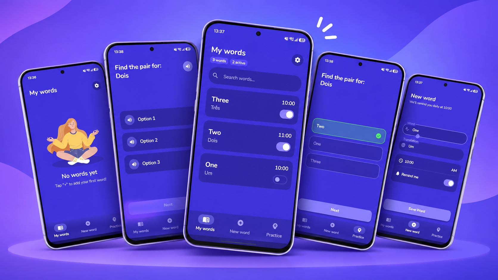

# Word Reminder

Word Reminder is an Android application designed to help you memorize new vocabulary effortlessly through scheduled daily notifications, text-to-speech pronunciation, and interactive practice quizzes.

  

  
  <b style="font-size: 1.25em; margin-left: 12px; vertical-align: middle;">Baixe na Google Play Store</b>

---

## ✨ Features

- 🔔 **Scheduled Reminders:** Set custom notification times for each vocabulary word to reinforce retention.
- 🔊 **Audio Pronunciation:** High-quality Text-to-Speech (TTS) to listen to native pronunciation with a single tap.
- 🧠 **Practice Mode:** Multiple quiz formats (word-to-translation, translation-to-word, and listening quizzes).
- 💾 **Backup & Restore:** Easily export and import your words list via JSON.
- 🎨 **Modern Material 3 Design:** Clean, distraction-free interface built with Jetpack Compose.
- 🛡️ **100% Free & Privacy-Friendly:** Completely offline and ad-free; your data never leaves your device.

---

## 🛠️ Built With

- **Language:** Kotlin
- **UI Framework:** Jetpack Compose (Material 3)
- **Architecture:** MVVM + Clean principles
- **Local Database:** Room Database with KSP
- **Monetization / In-App:** Google Play Billing Library 9
- **Asynchronous:** Kotlin Coroutines & StateFlow
- **Minimum SDK:** 24 (Android 7.0)
- **Target SDK:** 37 (Android 17)
